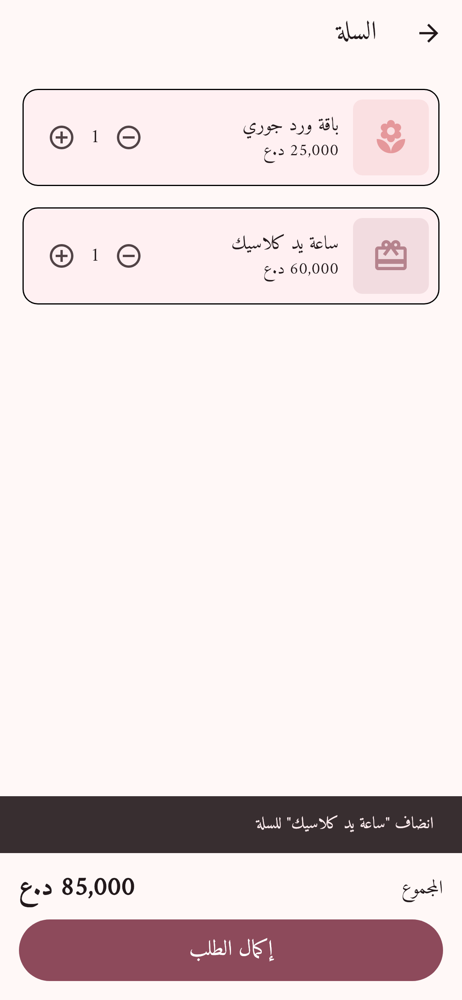
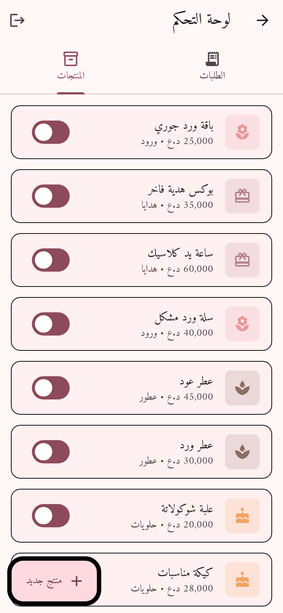
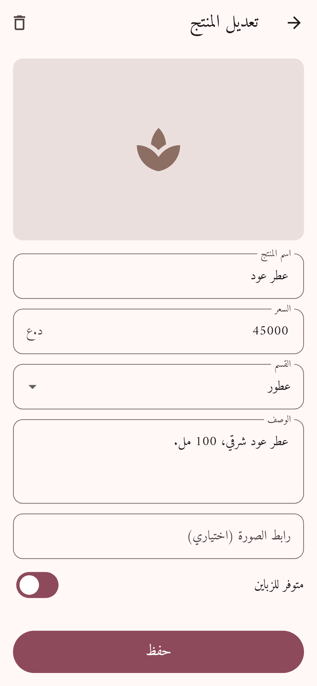

# متجر لاكاسا

تطبيق متجر للآيفون والأندرويد مبني بـ Flutter.

| الرئيسية | السلة | إكمال الطلب |
|---|---|---|
|  |  |  |

| الطلبات (المدير) | المنتجات (المدير) | تعديل منتج |
|---|---|---|
|  |  |  |

## الميزات
- واجهة عربية كاملة من اليمين لليسار بخط Amiri
- أقسام وبحث عن المنتجات
- صفحة لكل منتج مع اختيار الكمية
- سلة مشتريات
- إكمال الطلب (اسم، هاتف، عنوان، ملاحظات) والدفع عند الاستلام
- المنتجات والطلبات محفوظة بـ Firebase Firestore
- لوحة تحكم لصاحب المتجر (زر 🛡️ فوق بالصفحة الرئيسية):
  - متابعة الطلبات وتغيير حالتها (جديد، تم التأكيد، قيد التوصيل، تم التسليم، ملغي)
  - إضافة وتعديل وحذف المنتجات، وإخفاؤها عن الزباين
- إشعار بكل طلب جديد على مجموعة تليجرام (اختياري)

## إعداد Firebase (مرة وحدة)
المشروع: `lacasa-store-ef68f`. الإعدادات موجودة بـ `lib/firebase_options.dart`.

1. **قواعد الحماية:** انسخ محتوى `firestore.rules` والصقه بـ Firestore ← Rules، واضغط Publish.
2. **حساب المدير:** بـ Authentication ← Users ضيف إيميلك وباسورد.
3. **تفعيل المدير:** ادخل للوحة التحكم من التطبيق. راح يطلعلك رمز (UID).
   بـ Firestore ← Data سوي collection بأسم `admins`، وضيف document يكون الـ Document ID مالته هو هذا الرمز (الحقول تكدر تخليها فارغة، أو ضيف حقل مثل `name`).
4. اطلع وارجع ادخل للوحة التحكم.

## الصور
خطة Spark المجانية ما بيها رفع صور، فكل منتج ياخذ **رابط صورة** يبدي بـ `https://`.
إذا ماكو رابط، تبين أيقونة القسم.

## الأقسام
الأقسام ثابتة بملف `lib/data/catalog.dart`.

## إشعار تليجرام
التوكن ما ينكتب بالكود. ينطى وقت البناء:

```bash
flutter run --dart-define=BOT_TOKEN=xxxx --dart-define=CHAT_ID=-100xxxx
```

بـ GitHub: روح على Settings ← Secrets and variables ← Actions، وضيف `BOT_TOKEN` و `CHAT_ID`.
بدونهم الطلبات تنحفظ وتبين بلوحة التحكم بس ما يوصل إشعار.

## البناء
- **أندرويد:** `flutter build apk --release`
- **آيفون:** `flutter build ipa` (يحتاج جهاز Mac وحساب Apple Developer)

GitHub Actions (`.github/workflows/build.yml`) يبني نسخة APK ونسخة iOS غير موقعة مع كل push.
