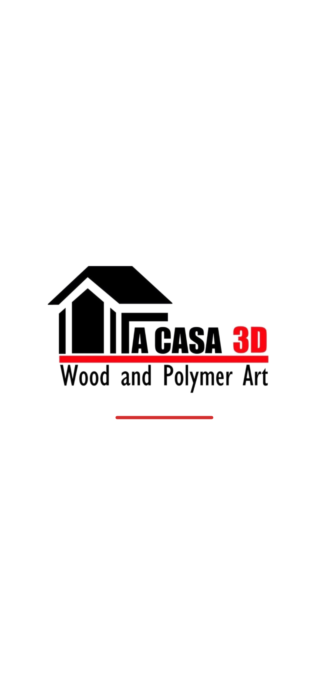
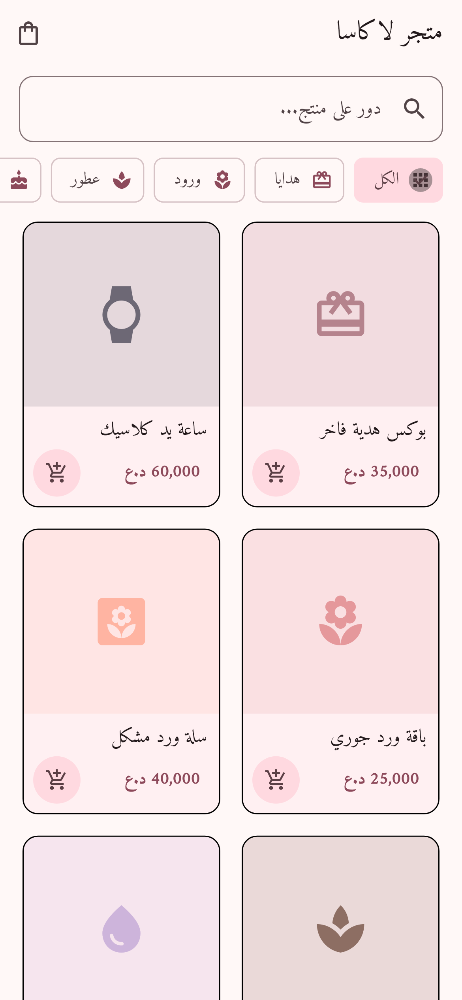
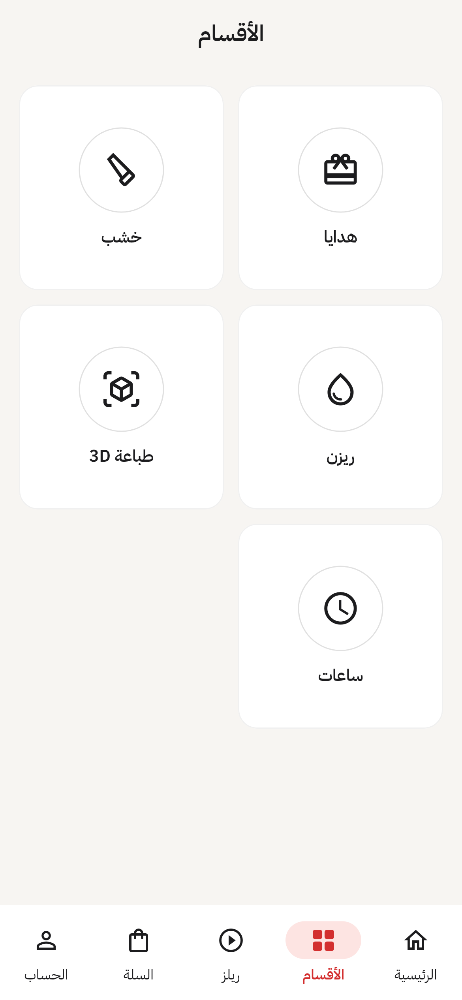
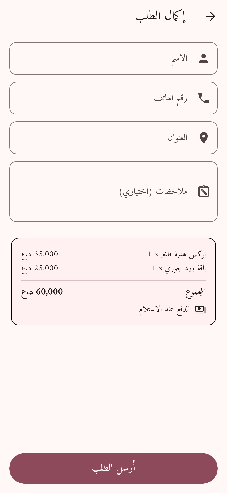
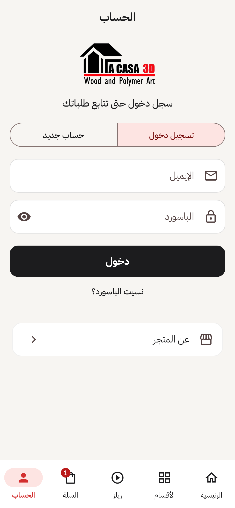
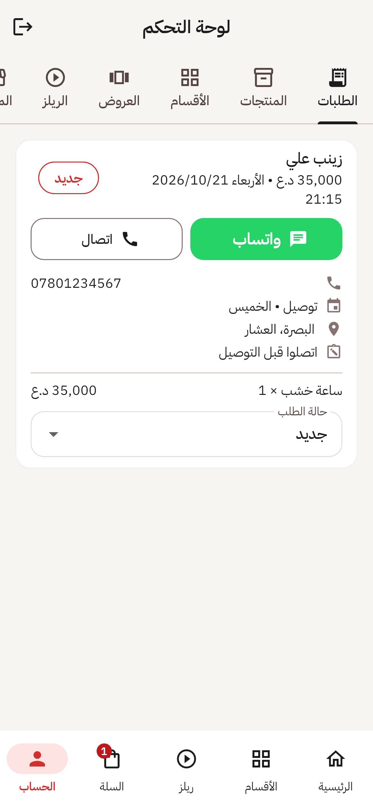
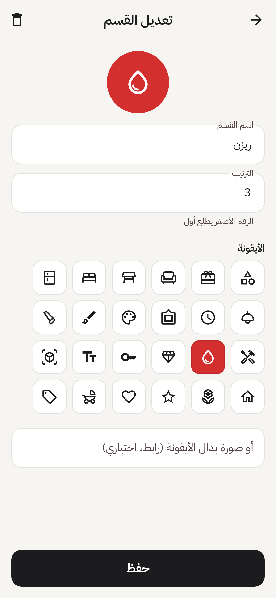

# La Casa 3D

تطبيق متجر La Casa 3D للآيفون والأندرويد، مبني بـ Flutter و Firebase.

| البداية | الرئيسية | الأقسام | إكمال الطلب |
|---|---|---|---|
|  |  |  |  |

| الحساب | لوحة التحكم: الطلبات | لوحة التحكم: تعديل قسم |
|---|---|---|
|  |  |  |

## للزبون
- شاشة بداية بحركة للشعار
- الأزرار اللي جوه: الرئيسية، الأقسام، ريلز، السلة، الحساب
- الرئيسية: مستطيل "ابحث في كل المنتجات"، بنر قلّاب للعروض، الأقسام، وكل المنتجات
- ريلز: فيديوهات عمودية، وزر يفتح المنتج المربوط بالفيديو
- إكمال الطلب: توصيل أو استلام من المحل، ويوم التسليم (السبت - الجمعة)، والدفع عند الاستلام
- الحساب: تسجيل دخول أو حساب جديد بالإيميل أو بحساب Google، طلباتي، معلوماتي، عن المتجر
- **طلب سريع:** زر "اطلب الآن" بصفحة المنتج يطلبه وحده بدون ما يلمس السلة
- **إعادة الطلب:** "اطلب مرة ثانية" بطلباتي يجيب الأسعار الحالية، ويبين شنو تغير وشنو ما متوفر
- **كوبونات ونقاط:** كوبون خصم بإكمال الطلب، ونقاط ولاء تنكسب بعد التسليم وتنستعمل خصم
- **محفظتي:** النقاط وحركاتها، الكوبونات الشخصية، وكود دعوة الأصدقاء
- **متابعة الطلب:** مراحل الطلب وأوقاتها؛ والزائر بدون حساب يتابع من "تتبع طلباتي" على نفس الجهاز
- **عروض ذكية:** منتجات تناسب مشتريات الزبون وسلته (مثل: بورد زواج ← عقود الزواج)
- الخط: بالآيفون خط النظام (SF Arabic)، وبالأندرويد IBM Plex Sans Arabic لأن خط Apple ما مسموح بغير أجهزتها

## لوحة التحكم
ما إلها أي زر ظاهر. صاحب المتجر يسجل دخول من تبويب "الحساب"، وإذا حسابه مدير تنفتح اللوحة مباشرة.

- **الطلبات:** معلومات الزبون، أزرار واتساب واتصال، يوم التسليم، وتغيير الحالة
- **المنتجات:** إضافة وتعديل وحذف وإخفاء
- **الأقسام:** الاسم والترتيب والأيقونة (من 24 أيقونة) أو صورة
- **العروض:** بنرات الصفحة الرئيسية، وكل بنر ممكن يفتح قسم
- **الريلز:** روابط فيديو مباشرة (mp4)، وكل فيديو ممكن يتربط بمنتج
- **المتجر:** نبذة، واتساب، رقم الاتصال، العنوان، أوقات الدوام، إنستغرام
- **التقارير:** المبيعات قبل وبعد الخصم، الخصومات (كوبونات ونقاط)، الكوبونات المستعملة، والزبائن الجدد والعائدين، لفترة تختارها
- **الكوبونات:** نسبة أو مبلغ، حد أدنى، أعلى خصم، تاريخ بداية ونهاية، عدد الاستعمال بالمجموع ولكل زبون، لأول طلب، أو شخصي لزبون واحد. الكوبون ما ينحذف، ينطفى
- **الولاء:** نقاط لكل 1,000 د.ع، قيمة النقطة، الحدود، ومكافآت الدعوة. وزر يوقف طلبات النسخ القديمة من التطبيق
- **عروض ذكية:** "إذا طلب كذا (كلمات أو أقسام) نبينله كذا"، وزر يضيف مثال الزواج والمولود

## إعداد Firebase
المشروع: `lacasa-store-ef68f`. الإعدادات موجودة بـ `lib/firebase_options.dart`.

1. **قواعد الحماية:** كل ما يتغير `firestore.rules`، انسخه كله والصقه بـ Firestore ← Rules، واضغط Publish.
2. **حساب المدير:** بـ Authentication ← Users ضيف إيميلك وباسورد، وبـ Firestore سوي document بـ `admins/{UID}`.

## مفتاح التوقيع (أندرويد)
GitHub Actions يوقع الـ APK بمفتاح ثابت إذا هذني الـ Secrets موجودة:

| Secret | القيمة |
|---|---|
| `ANDROID_KEYSTORE_BASE64` | ملف المفتاح `.jks` بصيغة base64 |
| `ANDROID_KEYSTORE_PASSWORD` | باسورد المفتاح (الـ alias هو `upload`) |

بدونهم يوقع بمفتاح debug يتغير كل بناء، فالتحديث ما ينصب فوق النسخة القديمة ودخول كوكل ما يشتغل.
**احتفظ بنسخة من ملف المفتاح والباسورد بمكان آمن.** خطوة "Show APK signing certificate" بالبناء تطبع بصمة SHA-1 و SHA-256.

## دخول كوكل
1. Firebase ← Project settings ← تطبيق الأندرويد ← **Add fingerprint**: ضيف SHA-1 و SHA-256 مال مفتاح التوقيع.
2. Authentication ← Sign-in method ← فعّل **Google**.
3. نزّل `google-services.json` و `GoogleService-Info.plist` من جديد، وحط القيم بـ `lib/google_sign_in_config.dart`:
   `googleWebClientId` (oauth_client بـ client_type: 3) و `googleIosClientId` (CLIENT_ID).
4. للآيفون: ضيف REVERSED_CLIENT_ID كـ URL scheme بـ `ios/Runner/Info.plist`.

الزر ما يبين إلا لما تنحط القيم.

## الصور والفيديوهات
لوحة التحكم بيها زر **"اختار صورة/فيديو من الموبايل"** يرفع الملف لـ Supabase Storage
(خطة Spark بـ Firebase ما بيها تخزين ملفات). وتبقى الخانة تقبل رابط `https://` من أي مكان.

الإعداد (مرة وحدة):
1. Supabase ← Authentication ← Third-party auth ← **Firebase**، بـ Project ID: `lacasa-store-ef68f`.
2. Storage ← New bucket اسمه `media` و **Public**، بحد 50 MB وأنواع `image/*, video/*`.
3. SQL Editor: الصق `supabase_storage.sql` (بيه رموز المدراء)، واضغط Run.
4. حط Project URL والمفتاح العام (anon/publishable) بـ `lib/supabase_config.dart`.

الزر ما يبين إلا لما تنحط القيم. الصور تتصغر بالموبايل قبل الرفع (عرض أقصاه 1600).
الفيديو أقصاه دقيقتين و50 MB؛ وأفضل يكون mp4، لأن فيديوهات الآيفون (HEVC) ما تشتغل على كل أجهزة الأندرويد.

## إشعار تليجرام (السيرفر)
الإشعار يندز من سيرفر صغير على Cloudflare Workers (مجلد `worker/` بأول المستودع)، مو من التطبيق،
فتوكن البوت ما يكون داخل الـ APK:

1. التطبيق يحفظ الطلب بـ Firestore، وبعدها يدز رقمه لـ `POST /notify-order`.
2. السيرفر يقرا الطلب بمفتاح خدمة Firebase، ويتأكد إنه جديد (أقل من ساعة) وما انبعث قبل.
3. يحط `notifiedAt` على الطلب بشرط ما تغير (حتى ما تنبعث الرسالة مرتين)، ويدز للتليجرام.

GitHub Secrets المطلوبة:

| Secret | شنو |
|---|---|
| `CLOUDFLARE_API_TOKEN` | توكن بقالب "Edit Cloudflare Workers" |
| `CLOUDFLARE_ACCOUNT_ID` | رقم حساب Cloudflare |
| `FIREBASE_SERVICE_ACCOUNT` | محتوى ملف مفتاح الخدمة (JSON) من Firebase ← Service accounts |
| `BOT_TOKEN` و `CHAT_ID` | البوت والمجموعة |

### الطلبات والخصومات بالسيرفر (`/api`)
النسخة الجديدة من التطبيق تطلب عن طريق السيرفر، مو مباشرة بـ Firestore، حتى الأسعار والخصومات
تنحسب من قاعدة البيانات نفسها ومحد يكدر يتلاعب بيها:

| المسار | شنو يسوي |
|---|---|
| `POST /api/quote` | يحسب السعر: الأسعار الحالية، الكوبون، النقاط |
| `POST /api/orders` | ينشئ الطلب بمعاملة وحدة (الطلب + النقاط + عداد الكوبون). نفس `requestId` ما يتكرر |
| `POST /api/orders/track` | الزائر يتابع طلبه بمفتاح المتابعة |
| `POST /api/admin/order-status` | المدير يغير الحالة؛ الإشعار مرة وحدة لكل حالة، والنقاط بعد التسليم مرة وحدة |
| `POST /api/referral/code` و `/api/referral/apply` | كود الدعوة وإضافته |

الهوية من توكن Firebase (`Authorization: Bearer`). الأرصدة (`wallets`) والدعوات واستعمال الكوبونات
يكتبها السيرفر بس، وقواعد Firestore تمنع التطبيق يكتبها.

اختبارات المحاكي (Firestore الحقيقي + القواعد، تحتاج Java): `cd worker/emulator-test && npm ci && npm test`.

السيرفر ينشر أوتوماتيكياً مع كل دمج بـ `master` (أو من زر Run workflow)، والتطبيق ياخذ رابطه
(`https://lacasa-store.<subdomain>.workers.dev/notify-order`) وقت البناء. اختبارات السيرفر: `cd worker && npm test`.

## الأيقونة
الأيقونة تنولد من `assets/icon/`:

```bash
dart run flutter_launcher_icons
```

## البناء
- **أندرويد:** `flutter build apk --release`
- **آيفون:** `flutter build ipa` (يحتاج جهاز Mac وحساب Apple Developer)

GitHub Actions (`.github/workflows/build.yml`) يبني نسخة APK ونسخة iOS غير موقعة مع كل push.
